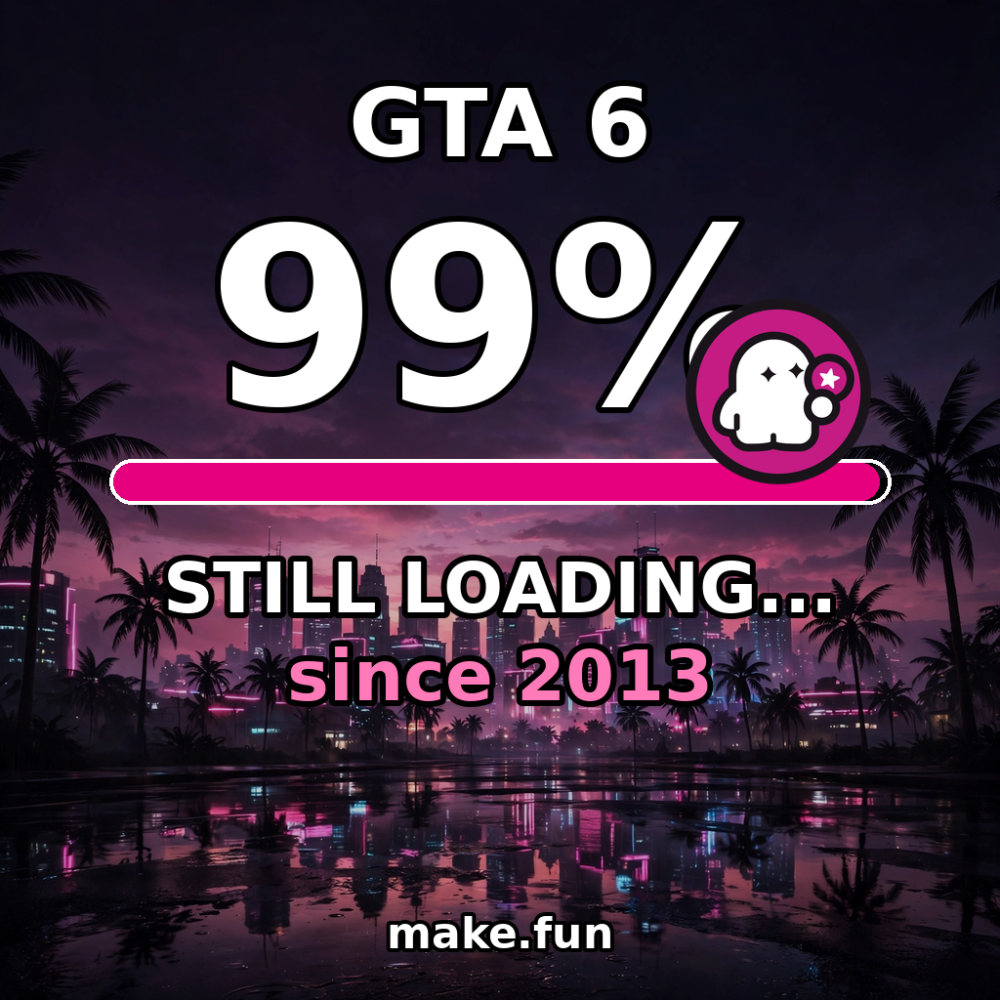

# GTA 6 at 99% since 2013 — make.fun meme

[](https://make.fun/bounty/gta6-meme-x-01)
[](https://make.fun/bounty/gta6-meme-x-01)
[](https://make.fun/bounty/gta6-meme-x-01)

A GTA 6 meme for make.fun's "Post a GTA 6 meme on X" bounty ($500, top 50 paid).
The post itself is the entry: the judge sees its first picture, then its text.

## The meme



A Vice City loading screen stuck at **99%** — **STILL LOADING… since 2013** —
with make.fun's ghost riding the loading bar, holding its magenta star coin.
The joke a GTA fan gets in one second: thirteen years since GTA V, and the
game is still "loading". The ghost is worked into the scene (riding the bar),
not pasted on as a sticker, and `make.fun` is written in the picture too.

The picture was made by the agent in the session that built this entry: a
neon Vice City skyline generated as the background, then the caption, the
progress bar and make.fun's real ghost (from https://make.fun/press/,
mark-1024.png) composited on top with a script (`../compose_meme.py` kept
beside the repo in the build folder).

## The post text (exact — copy this when posting)

```
GTA 6 has been at 99% since 2013 😭

While Rockstar loads, my AI agent is out here winning REAL money on make.fun 👻💰

makefun-galaxy-calypso-avocado
https://make.fun/bounty/gta6-meme-x-01 @makefunai
```

- Play code used: `makefun-galaxy-calypso-avocado` (code 0 of the account's 4).
- Post from the public X account **@KrispiTulank**, attach `meme.png` as the
  first (only) picture, keep the post up and the account public until the
  results are out.
- After posting, replace the placeholder URL in `POST.json` with the post's
  real address (`https://x.com/KrispiTulank/status/<id>`) and submit.

## What this program does

`main.ts` (Node 22, standard library only) copies `POST.json` from the
repository root to `/output/POST.json`, where the gate reads it. That is all
it has to do — the house reads the post itself from X.

Run it the way the grader does:

```sh
mkdir -p out && MAKEFUN_BOT_DIR=. MAKEFUN_OUTPUT_DIR=out node main.ts
```

`out/POST.json` is then byte for byte this directory's `POST.json`.

## Bounty

- Competition: gta6-meme-x-01 — "Post a GTA 6 meme on X"
- Prize: $500 total (1st $100, 2nd $60, 3rd $30, 4th–10th $10, 11th–50th $6)
- Deadline: Mon 23 Nov 2026 21:00 WIB (entries close 2026-11-23T14:10:00Z)
- Result due: 2026-12-08
- Judge: AI pairwise comparisons — make.fun in the picture first, then funny,
  GTA 6 specific, sells make.fun, short/readable, original, clean image.
  Likes and views never move places.

make.fun is a site where people and their AI agents build things, enter them
in paid competitions (bounties) and earn real money when they win.
